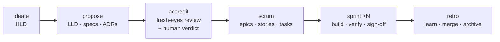

# Ayuna specmaker

**Spec-driven development for coding agents, as plain Agent Skills.** Specmaker
takes an idea through six phases:

- a high-level design written in conversation
- a reviewed and approved low-level design with testable specs
- an agile backlog
- verified sprints
- living specs that accumulate with your system

It is built first for [OpenCode](https://opencode.ai) and works with any harness
that reads `SKILL.md` folders (Claude Code, Codex and others). There are no
slash commands to learn: you talk to your agent, and it loads the right phase.



| Phase | Skill | You get |
|---|---|---|
| ideate | `specmaker-ideate` | `hld.md`: problem, goals, non-goals, success measures, alternatives, risks. Shaped by a challenging, one-question-at-a-time conversation |
| propose | `specmaker-propose` | `lld.md`, delta specs with requirement and scenario IDs, ADRs for framework, data and deployment decisions, contracts |
| accredit | `specmaker-accredit` | Reports from context-free reviewers, triage to convergence, `accreditation.md`, a named human's verdict. The design is then **locked** (hashed) |
| scrum | `specmaker-scrum` | `backlog.md`: epics → features → stories (covering scenario IDs) → tasks (with exact files), estimates, a sprint plan, CSV export |
| sprint | `specmaker-sprint` | Test-first code inside the agreed file boundary; script-run quality gates; scenario→test trace; a fresh verifier; a named human's sign-off |
| retro | `specmaker-retro` | Metrics and lessons fed back into `project.md`; delta specs merged into living specs by ID; ADRs promoted; the change archived. Also runs drift checks |

The core skill, `specmaker`, sets up the workspace, decides how much process a
change deserves (**skip / lite / full**), and resumes work from the files. It
also carries a multi-language
[naming convention](skills/specmaker/references/naming.md) that every phase and
reviewer applies.

## Why specmaker

It adapts the best of two projects, and fixes what their users complain about.

- **From the [Elephant-Goldfish Model](https://egm.dev):** an author with full
  context ("elephant") and reviewers with none ("goldfish"). Reviewers with no
  context find the gaps the author cannot see.
- **From [OpenSpec](https://github.com/Fission-AI/OpenSpec):** delta specs
  (ADDED / MODIFIED / REMOVED) that merge into living specs, so the source of
  truth grows with the system.
- **Added:**
  - stable requirement IDs and an ID-based merge that verifies itself
  - review findings that must cite evidence
  - a ledger that stops reviewers from re-raising settled points
  - cost presets for reviews
  - a design lock
  - quality gates that the script runs and records against a commit
  - file-boundary enforcement during sprints
  - scenario→test traceability
  - an agile planning layer
  - ADRs that outlive the change

It also keeps change requests from eroding the specs. Requests are recorded
and parked, and sprints are frozen except for blockers. Parked requests are
triaged in batches by a human, then applied deliberately: a rewind if needed,
the HLD or LLD, re-approval, and automatically reopened sprints.

[docs/design.md](docs/design.md) maps each choice to the GitHub issues that
motivated it.

## Install

You need Linux, macOS or WSL2, with Python 3.8+ and OpenSSH 8.1+ (used to sign
human approvals). Git is recommended. Always install **all seven** skills: the phase skills rely on the
core `specmaker` skill.

**Any agent, with the [skills CLI](https://skills.sh)** (OpenCode, Claude Code,
Codex, Cursor and 70+ more), run in your project:

```bash
npx skills add ayunaoss/ayuna-specmaker --skill '*' -a opencode -a claude-code
```

**Claude Code plugin:**

```bash
claude plugin marketplace add ayunaoss/ayuna-specmaker
```

```bash
claude plugin install specmaker@ayuna
```

Inside a session: `/plugin marketplace add ayunaoss/ayuna-specmaker`, then
`/plugin install specmaker@ayuna`.

**Without Node, from a clone:**

```bash
../ayuna-specmaker/install.sh
```

This installs into `.agents/skills/`, the shared folder that OpenCode, Codex,
Cursor and others read. Use `--agent claude` for Claude Code,
`--agent opencode` for `.opencode/skills/`, `--global` for
your user folder, `--link` to symlink, and `--explicit-only` so the skills
load only when you name them.

Details and invocation per agent are in [HOW-TO §1–2](docs/how-to.md#1-install).

## Quick start

In OpenCode, inside your project:

```text
@specmaker set this project up
```

The agent creates `specmaker/` and fills in `project.md` with you. Most
importantly, it fills in **Quality Gates**: the commands that must pass before
any sprint is signed off. Then:

```text
@specmaker Session tokens never expire. I want them to time out after inactivity.
```

From there the agent guides you phase by phase. It asks one question at a
time and writes every artifact to a file. At the points where a human must
decide, the agent prints one command for you to run in your own terminal:
approving the design, signing off a sprint, deciding a change request, and
discarding code. The command **signs** the decision with your SSH key; a
hardware key needs a touch. Later steps, and CI, verify those signatures, so
an agent cannot approve its own work (see
[HOW-TO §4.4](docs/how-to.md#44-accredit--reviews-verdict-lock)). Register
your key once first: `approvers add` ([HOW-TO §3](docs/how-to.md#3-set-up-a-project)).
To pick up later, in any new session:

```text
@specmaker where are we?
```

## Learn by example

| Read | For |
|---|---|
| [docs/walkthrough.md](docs/walkthrough.md) | A real change, "idle session timeout", told as a story from idea to archive |
| [examples/acme-notes](examples/acme-notes) | Every artifact of that change, plus the code and tests; run the final archive step yourself |
| [docs/how-to.md](docs/how-to.md) | 21 recipes: lite changes, adopting an existing codebase, handling findings, deviations and amendments, tagging tests, exporting to Jira, drift checks, CI, troubleshooting, and the full command reference |
| [docs/design.md](docs/design.md) | Architecture, provenance, and the user feedback behind each decision |

## Repository layout

```text
skills/
  specmaker/            core: triage, routing, conventions, spec format, goldfish protocol
    scripts/specmaker.py  deterministic helper (gates, lint, lock, trace, merge, gates runner)
    references/  assets/templates/project.md
  specmaker-ideate/     SKILL.md, references/lenses.md, assets/templates/hld.md
  specmaker-propose/    SKILL.md, references/adr-guide.md, assets/templates/{lld,spec,adr}.md
  specmaker-accredit/   SKILL.md, references/personas/*.md, assets/templates/accreditation.md
  specmaker-scrum/      SKILL.md, references/agile-guide.md, assets/templates/backlog.md
  specmaker-sprint/     SKILL.md, references/personas/verifier.md, assets/templates/sprint.md
  specmaker-retro/      SKILL.md, assets/templates/retro.md
examples/acme-notes/    worked example project
docs/                   how-to, walkthrough, design
tests/                  script tests, including checks that the example stays valid
install.sh
LICENSE                 MIT
```

## What lives in your project

```text
specmaker/
  project.md                  charter: stack, conventions, quality gates, review policy, approvers
  specs/<capability>/spec.md  living specs (source of truth; written only by archive)
  adrs/                       project-wide decision log
  changes/<change-id>/        one folder per change in flight
  archive/YYYY-MM-DD-<id>/    finished changes
```

Commit `specmaker/` with your code.

## Development

```bash
python3 -m unittest discover -s tests -v
```

The tests drive the script through complete lifecycles in temporary git
repositories, including:

- lock breaks and out-of-boundary files
- stale gate runs and missing tests
- base drift between concurrent changes

They also check that the worked example still passes every check.

## Licence and attribution

MIT. See [LICENSE](LICENSE).

Concepts are adapted from the Elephant-Goldfish Model (Google, Apache-2.0) and
OpenSpec (Fission AI, MIT). Specmaker's text and code are original.
