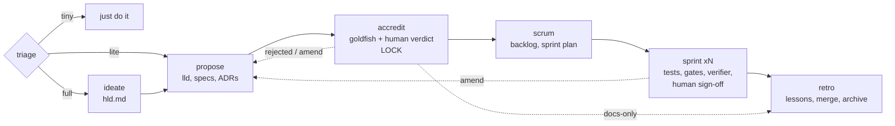

# Design: how specmaker was put together, and why

Specmaker adapts the strongest ideas of two open-source spec-driven workflows:

- [Elephant-Goldfish Model (EGM)](https://github.com/google/elephant-goldfish-model),
  Apache-2.0
- [OpenSpec](https://github.com/Fission-AI/OpenSpec), MIT

Specmaker itself is MIT-licensed. It also adds an agile delivery layer that neither has. No text or code was
copied: specmaker re-implements the concepts with its own wording, formats and
script. This document explains what was taken, what was changed, and the user
feedback behind each choice.

## 1. Principles

1. **Skills only.** No slash commands and no agent files are required. Each
   phase is an [Agent Skill](https://opencode.ai/docs/skills/) folder with
   `SKILL.md`, `references/`, `assets/` and (in the core skill) `scripts/`. The
   same folders work in OpenCode, Claude Code and other harnesses that read
   `SKILL.md`.
2. **Judgement in skills, rules in a script.** The model does conversation,
   drafting and review. A standard-library Python script does everything that
   must not depend on a model:
   - phase gates
   - artifact lint
   - the accreditation lock
   - running quality gates
   - traceability
   - the spec merge
3. **Files are the memory.** Every decision, finding and verdict is on disk.
   Any session can resume from `status` and the ledger.
4. **Fresh eyes review, humans decide.** Context-free reviewers find the gaps.
   Only a named human can approve a design or sign off a sprint.
5. **Evidence over claims.** Sign-off checks:
   - gate results recorded against a commit
   - tests found by scenario ID
   - changed files compared with the plan

## 2. What came from where

| Idea | Source | Specmaker form |
|---|---|---|
| Elephant drafts with full context; goldfish review with none | EGM | `references/goldfish.md`; reviewers get file paths only |
| Conversational brainstorming that challenges the user, one question at a time | EGM brainstorm | `specmaker-ideate` → `hld.md` |
| Section-by-section drafting with consensus gates and contradiction stops | EGM draft | `specmaker-propose` |
| Staged persona reviews (zoom-out, comprehension, critic, readiness) | EGM review | `specmaker-accredit` presets and personas |
| Paraphrase-first comprehension test | EGM comprehension persona | `personas/comprehension.md` |
| Zero-decision implementation readiness standard | EGM standards | `personas/readiness.md` |
| Finding triage: fix / contest / decline / escalate | EGM resolve | Convergence rules in `goldfish.md` |
| Drift report between design and code | EGM drift-report | `specmaker-retro` part B + `coverage` |
| Living specs vs change folders | OpenSpec | `specmaker/specs/` vs `specmaker/changes/<id>/` |
| Delta specs (ADDED / MODIFIED / REMOVED), SHALL + WHEN/THEN scenarios | OpenSpec | `references/spec-format.md` |
| Archive merges deltas into living specs | OpenSpec | `specmaker.py archive` |
| Project context and per-artifact rules (`config.yaml`) | OpenSpec | `specmaker/project.md` (Rules by Phase) |
| Explore before proposing | OpenSpec explore | ideate phase |
| Epics → features → stories → tasks, sprints, DoR/DoD | Agile/Scrum | `specmaker-scrum`, `specmaker-sprint` |
| ADRs as first-class, project-wide records | (requested by OpenSpec users) | `adrs/` per change, promoted to `specmaker/adrs/` |

## 3. User feedback that changed the design

Before building, we read the issue trackers and discussions of both projects:

- EGM: about 170 issues and 19 discussions, plus Hacker News and blog posts
- OpenSpec: about 816 issues, ranked by activity, with the top 45 issues and
  12 discussions read in full, plus outside reviews

The table maps each recurring complaint to a decision. Issue numbers refer to
each project's GitHub repository.

| Pain reported | Evidence | Specmaker decision |
|---|---|---|
| Reviews never converge; reviewers re-open settled decisions; findings with no basis | EGM HN thread, #408, #433 | Every finding cites evidence (`doc:`/`code:`/`absent:`) or is a non-blocking `question`. An append-only ledger is given to reviewers so declined items are not re-raised. Re-review covers changed sections only. Hard round cap |
| Token cost of reviewer swarms | EGM #385, #528 | Presets (2 / 5 / 7 reviewers) chosen by risk; reviewer count stated before dispatch; reports written per reviewer so an interrupted run resumes without repeating work |
| State lost on context compaction; files overwritten across features | EGM #437, #278, #448 | Per-change folders; round-numbered reports; script-owned `change.json`; `status` prints the next step |
| No implementation or verification phase after the spec | EGM #367, #436 | Sprint phase with recorded git base, script-run quality gates, a scenario→test trace, a fresh verifier and a human sign-off |
| Reviewer isolation leaks (AGENTS.md injected, parent context visible) | EGM #237, #146 | Isolation probe before the first dispatch; partial isolation is recorded in each report; cold-read fallback in a new session instead of a fake review |
| Same model drafts and reviews, sharing blind spots | EGM #358 | Optional reviewer model or agent in `project.md`; the model is recorded in each report |
| Long, rule-heavy prompts; resource paths failing on some harnesses | EGM #371, #455, #477 | Shared rules in one `conventions.md`; each SKILL.md is small; plain relative paths to the sibling `../specmaker/`; few "CRITICAL" markers |
| Too heavy for small changes | EGM #460, #258; OpenSpec bake-off (D#1159) | Triage: skip / lite / full; lite track skips HLD and epics and uses the quick preset |
| Gates block automation, yet some users want hands-on control | EGM #288, Herd spike | `Autonomy: guided \| autopilot`; only the four human gates are absolute (verdict, sprint sign-off, change-request decision, rewind) |
| Merge by header text is fragile: renames, dropped scenarios, conflicting changes | OpenSpec #1112, #1246, #1697, #2033 | Stable requirement and scenario IDs; merge by ID; no RENAMED (renames are MODIFIED); independent post-merge verification; base-hash check against concurrent changes; `depends_on` |
| Ticked checkboxes are not evidence; archive with zero tasks done | OpenSpec #1652, #1142 | Gates run by the script and recorded with a commit SHA; sign-off re-checks everything; archive requires all sprints signed off |
| No cross-artifact review; contradictions between design and specs | OpenSpec #783 | A dedicated `consistency` reviewer is required on every full-track change |
| ADRs and design docs disappear into the archive | OpenSpec #557, #1980 | ADRs promoted to the project-wide `specmaker/adrs/` at archive |
| No traceability between requirements, tests and code | OpenSpec D#743, #2167 | `trace` and `coverage` find scenario IDs in test files |
| Skills fire in projects that never set them up; users want explicit-only | OpenSpec #1645, #2156 | Workspace guard in every skill; installer `--explicit-only` |
| A gate that relies on "no terminal" can be faked with a pty wrapper, and a sandbox doesn't help | Our own audit (2026-11-25) | `Human gates: signed` (default): every human decision is a statement bound to what was approved (design lock digest, sprint run and evidence digests, request decision), SSH-signed (`ssh-keygen -Y`, namespace `specmaker`) and verified against an allowed-signers file outside the repository. Statements form a hash-linked, gap-free chain bound to the change's unique ID and the repository's root commit; every record must match its statement field for field and every statement must belong to a record; sign-offs are re-checked against current evidence, approved requirement text and later rewinds; request statuses must follow from signed decisions (all found necessary by a second independent review, which forged approvals against a field-subset design); hardware (sk) keys need a touch; `verify --require-signed` in CI, with a signer list from CI configuration, is the enforcement point an agent cannot fake. OpenSSH 8.1+ is a hard requirement. For the weaker `terminal` mode: Each decision records its terminal and parent processes; `status` flags decisions recorded inside an agent's process tree; the gate mode fails closed and is fixed per change; conventions forbid terminal wrappers. `change.json` is not tamper-proof either; it is committed, so git history is the audit trail |
| An agent that cannot ask approves on its own | Our OpenCode 2.4.1 test: in a non-interactive run, the question tool was cancelled with "make reasonable assumptions", and the agent recorded an accreditation under the approver named in `project.md` | `Human gates: terminal` (default): `accredit` and `signoff` record only when a person types a name at an interactive terminal (agent shells have none). Skills also say that not being able to ask is never a reason to pass a gate |
| Agents ignore installed skills and improvise from the files | Our own OpenCode 2.4.1 test: "where are we?" was answered without loading the skill | `init` writes a managed block into `AGENTS.md` telling agents to load `specmaker` first |
| Need to fix plans after apply | OpenSpec #821, #618 | `amend` reopens the design deliberately; the lock makes accidental edits visible |
| Random change requests mid-implementation create noise and erode the specs | The user's experience with OpenSpec; the same issues lack any intake control | Change requests are recorded and parked (`cr add`); a sprint freeze admits only blockers; parked requests are triaged in batches at sprint boundaries by a human (`cr decide`); class 0–3 decides where a request re-enters; `impact` traces changed requirements to stories, tests and sprints; `rewind` discards code with a backup and a new commit; re-approval reopens affected signed-off sprints, which must produce fresh evidence; an amendment budget flags a design that no longer fits |
| Brownfield: generate specs from existing code | OpenSpec #724, D#739 | Adopt flow: docs-only baseline changes, one capability at a time, with code citations |
| Large or hierarchical specs, configurable root | OpenSpec #662, #697 | Nested capability paths (`billing/invoices`); `--root` and `SPECMAKER_ROOT`; spec hygiene guidance in retro |
| Change wording leaks into living specs | OpenSpec #678 | Deltas are written in end-state, present tense from the start; retro checks the wording |
| Tickets for teams | EGM #415 | `export --format csv\|json` |
| Docs become unreadable to humans | EGM D#563, #214 | TL;DR block required; word budgets; plain-English rules |

What both communities praised, and specmaker keeps:

- the fresh-context reviewer idea and its rigour
- living specs that build up over time
- a lightweight footprint that works with any tool
- humans staying in the design loop
- a deterministic merge that CI can check

## 4. Phase model

| Gate | Enforced by | Human needed |
|---|---|---|
| ideate → propose | HLD lint | Agreement (guided mode) |
| propose → accredit | Design lint (HLD, LLD, specs, ADRs) | Agreement (guided mode) |
| verdict | Lint + minimum lenses + accreditation record | **Yes, SSH-signed** (or typed at a terminal, or named in chat, if configured) |
| accredit → scrum | Verdict approved or conditional, lock intact | No |
| scrum → sprint | Backlog lint (coverage, files, dependencies, plan) | Agreement (guided mode) |
| sprint sign-off | Tasks, deviations, gates at HEAD, verifier verdict, lock, boundary, trace | **Yes, SSH-signed** (or typed at a terminal, or named in chat, if configured) |
| sprint → retro | All planned sprints signed off | No |
| archive | Dependencies archived, no base drift, merge verified | Agreement |

## 5. Harness portability

| Concern | Approach |
|---|---|
| Discovery | Standard `<name>/SKILL.md` folders; names match `^[a-z0-9]+(-[a-z0-9]+)*$`; frontmatter limited to `name`, `description`, `license`, `compatibility`, `metadata` |
| Shared files | The installer keeps all seven skills side by side. Each SKILL.md starts with a one-line locate command (`$SPECMAKER_HOME`, then project and global skill folders), because OpenCode 2.4 hands the agent the skill text without its folder path (verified while building: the agent had to search for the script) |
| Subagents | `goldfish.md` maps the dispatch tool per harness (OpenCode `task`/`subagent`, Claude Code `Agent`, Codex `spawn_agent`, Antigravity `invoke_subagent`) |
| No subagents | Cold-read mode via a new session |
| Script | Python 3.8+ standard library only; no network; git optional; OpenSSH 8.1+ required for signed human gates. Supported: Linux, macOS, WSL2 |
| Distribution | `skills/` is discovered by the `npx skills` CLI, which copies whole folders, keeps them as siblings and keeps the executable bit. The repository root is also a Claude Code plugin and a one-plugin marketplace (`.claude-plugin/plugin.json`, `marketplace.json`); `claude plugin validate .` passes. `install.sh` covers setups without Node |
| Claude Code locate | `${CLAUDE_SKILL_DIR}` is substituted in the skill text, so the locate command's first candidate is exact in plugin and plain-skills modes. The plugin cache (`~/.claude/plugins/cache/*/specmaker/*/`) is a fallback |
| Project instructions | `init` writes the managed block to `AGENTS.md`, and also to `CLAUDE.md` when one exists, because Claude Code reads `AGENTS.md` only when there is no `CLAUDE.md` |

Roadmap:

- An Antigravity extension and a Codex plugin manifest wrapping the same skill
  folders. Claude Code and the skills CLI are already supported.
- Optional per-harness reviewer agent definitions with read-only permissions.
- Spec stores shared across repositories.
- A `doctor` command that verifies the installation and reviewer isolation.
