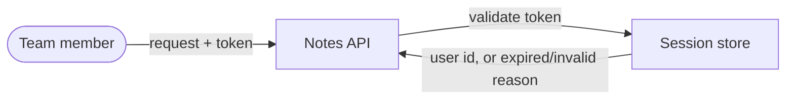

# HLD: Idle session timeout

> **TL;DR** Session tokens never expire today, so a token copied from a shared
> laptop works forever. We will end sessions after 30 idle minutes and after
> 12 hours in total. The trade-off: some users will sign in more often.
> Decide: are 30 minutes and 12 hours acceptable to the support team?

- Change: `idle-session-timeout`
- Author: Alex Chen
- Date: 2026-11-03
- Status: Accepted

## 1. Problem Statement

A session token stays valid until the user explicitly signs out, and most users
never sign out. The October security review found tokens in a shared-laptop
browser profile that were five weeks old and still worked. Anyone who copies a
token, or sits down at an unlocked shared machine, gets indefinite access to a
team's notes.

## 2. Users and Stakeholders

- Team members using Acme Notes daily. They are affected by being signed out.
- The security team. They raised the finding and must accept the fix.
- Support. They will get "why was I signed out?" tickets.

## 3. Goals

- G1: A token stops working after 30 minutes without use.
- G2: No token works for more than 12 hours after sign-in, even if used.
- G3: Clients can tell an expired session apart from an invalid one, so they
  can show "please sign in again" instead of a generic error.

## 4. Non-Goals

- NG1: Persistent "remember me" sessions. These are a separate change, if ever.
- NG2: Revoking all of a user's sessions at once (for example on a password
  change). It needs a user-to-token index; deferred.
- NG3: Multi-factor authentication.

## 5. Success Measures

| Measure | Baseline | Target | How measured |
|---|---|---|---|
| Oldest token accepted (hours) | unbounded | 12 or less | Weekly security probe replays a 13-hour-old token |
| Sign-in support tickets per week | 2 | 5 or fewer | Support tag `signed-out` |

## 6. Constraints and Assumptions

- No new runtime dependencies (project charter).
- Sessions stay in memory; a restart signing everyone out is acceptable.
- Assumption: 30 minutes matches the company's laptop screen-lock policy. Confirmed with security (L-001).

## 7. Solution Overview

The session store already looks up every token on every request. It will also
remember when each session was created and when it was last used. On each
lookup it rejects the token if either limit has passed, giving a distinct
reason, and otherwise refreshes the last-used time.

## 8. Alternatives Weighed

### A1: Fixed lifetime only (12 hours)
- Why not: a token left on a shared laptop stays usable for up to 12 hours,
  which does not address the finding.

### A2: Signed, self-expiring tokens (JWT-style)
- Why not: we would need a signing library or our own crypto code, which
  breaks the no-dependency rule, and sign-out would then need a deny-list
  anyway (L-002).

### A3: Rely on the reverse proxy's idle timeout
- Why not: the proxy times out connections, not application sessions, and
  clients reconnect transparently.

## 9. Risks and Open Questions

| Risk | Likelihood | Impact | Mitigation |
|---|---|---|---|
| Users lose unsaved note text when signed out | Medium | Medium | Client keeps drafts locally (client team, outside this change) |
| Clock jumps make sessions expire early | Low | Low | Use one injected UTC clock; tests use a fake clock |

- [x] Is 30 minutes acceptable to security? Yes (L-001).

## 10. Key Decisions Carried Forward

- Idle timeout 30 minutes plus absolute lifetime 12 hours (L-001).
- Server-side session records, not self-expiring tokens (L-002) (ADR).
- Distinct reason codes for expired versus invalid tokens (G3).
