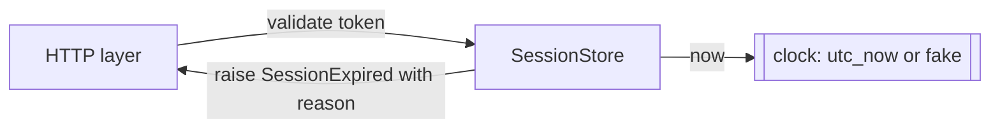

# LLD: Idle session timeout

> **TL;DR** `SessionStore` records `created_at` and `last_seen` per token and
> checks both on every `validate()`: 30 idle minutes gives `session_expired`;
> 12 hours since sign-in gives `session_lifetime_exceeded`. Time comes from an
> injected clock (ADR-0002). There are two sprints: the clock and idle expiry
> first, then the absolute lifetime.

- Change: `idle-session-timeout`
- HLD: [hld.md](hld.md)
- Author: Alex Chen
- Date: 2026-11-05

## 1. Context and Scope

This covers HLD goals G1 to G3 inside `src/notes/session.py`. Sign-in
credential checking, the HTTP layer, and clients are unchanged. The HTTP layer
already maps `SessionExpired.reason` to a 401 response body, which is how G3
reaches clients.

## 2. Architecture

There are no new components. `SessionStore` gains time awareness through a
clock function passed to its constructor.

## 3. Data Model

`Session` (dataclass, in memory, keyed by token):

| Field | Type | Meaning |
|---|---|---|
| user_id | str | Owner of the session (unchanged) |
| created_at | datetime (UTC, aware) | Time of sign-in; never changes |
| last_seen | datetime (UTC, aware) | Time of the last successful `validate()` |

Existing sessions are lost on deploy, because the store is in memory. That is
an accepted behaviour (project charter), so no migration is needed.

## 4. Interfaces and Contracts

- `SessionStore(clock: Clock = utc_now)`: new optional parameter.
- `SessionStore.validate(token) -> str` raises `SessionExpired(reason)`, where
  `reason` is one of:
  - `session_invalid`: the token is unknown or signed out (existing)
  - `session_expired`: the idle limit was reached (new)
  - `session_lifetime_exceeded`: the absolute limit was reached (new)
- `Clock = Callable[[], datetime]` in the new module `src/notes/clock.py`.
- Contracts directory: N/A - an in-process API only; the HTTP error body shape
  is unchanged.

## 5. Behaviour and Error Handling

`validate(token)`, in this order:

1. Unknown token: raise `session_invalid`.
2. `now - created_at >= ABSOLUTE_LIFETIME` (12 hours): delete the session, raise
   `session_lifetime_exceeded`. Checked first, so a 12-hour-old idle session
   reports the absolute limit.
3. `now - last_seen >= IDLE_TIMEOUT` (30 minutes): delete the session, raise
   `session_expired`.
4. Otherwise set `last_seen = now` and return `user_id`.

The limits are inclusive: exactly 30 minutes idle has expired. Both are module
constants (charter rule). An expired session is deleted when it is detected.
There is no background sweeper (see section 8).

## 6. Cross-Cutting Concerns

- Security: tokens stay `secrets.token_urlsafe(32)`. Expiry reasons reveal only
  that a token once existed, which is acceptable because tokens are
  unguessable.
- Performance: two datetime comparisons per request, which is negligible.
- Observability: N/A - the HTTP layer already logs 401 reasons.
- Privacy, accessibility, i18n: N/A - no new data or UI.

## 7. Technology and Deployment

Standard library only (`datetime`, `dataclasses`). The change ships in the
normal release. There are no config keys: the limits are constants by
decision (L-001). See ADR-0001 (server-side records) and ADR-0002 (injected
clock).

## 8. Alternatives Considered

- **Background sweeper thread** to purge expired sessions: rejected. Lazy
  deletion is enough at our volume (about 200 sessions), and threads
  complicate tests.
- **Store `expires_at` instead of `last_seen`**: rejected. Two timestamps
  express both rules directly and keep the reason codes obvious.

## 9. Test Strategy

Unit tests in `tests/test_session.py`, using a `FakeClock` that the test
advances. There is one test per scenario, named `test_<what>__SESS_NN_n`, with
a `covers: SESS-NN.n` docstring. The boundary cases (exactly 30 minutes) are
asserted inside the scenario tests. No integration tests are needed: the HTTP
mapping of reasons is unchanged and already tested.

## 10. Migration and Rollout

Deploying restarts the process, which signs everyone out once; that is normal
for any release. Rollback means redeploying the previous version.

## 11. Implementation Phases

| Phase | Delivers | Scenarios | Exit check |
|---|---|---|---|
| P1 | Injectable clock; idle expiry and refresh | SESS-02.1, SESS-02.2, SESS-02.3 | quality gates green |
| P2 | Absolute lifetime | SESS-03.1 | quality gates green |

## 12. File Boundary

| Path | C/M/D | Phase | Note |
|---|---|---|---|
| src/notes/clock.py | C | P1 | `Clock` type and `utc_now()` |
| src/notes/session.py | M | P1, P2 | timestamps, limits, reasons |
| tests/test_session.py | M | P1, P2 | `FakeClock`, scenario tests |

## 13. Risks and Mitigations

| Risk | Likelihood | Impact | Mitigation | Owner |
|---|---|---|---|---|
| A naive datetime slips in and comparisons fail | Low | Medium | `utc_now()` returns aware datetimes; `FakeClock` uses aware datetimes too | Alex |

## 14. Traceability

| Capability | Requirements | HLD goal |
|---|---|---|
| identity/session | SESS-02 (modified) | G1, G3 |
| identity/session | SESS-03 (added) | G2, G3 |
