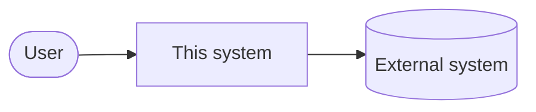

# HLD: <!-- title -->

> **TL;DR** <!-- Up to 5 lines: the problem, the proposed shape, the main trade-off, and what the reader must decide. Write this last. -->

- Change: `<!-- change-id -->`
- Author: <!-- from git config user.name, or ask -->
- Date: <!-- YYYY-MM-DD -->
- Status: Draft

## 1. Problem Statement

<!-- What hurts, for whom, how often, and what it costs today. How is it handled now, and why is that not enough? -->

## 2. Users and Stakeholders

<!-- Who uses it, who operates it, who pays, who can say no. One line each. -->

## 3. Goals

<!-- Outcomes, not features. Numbered so later documents can refer to them (G1, G2...). -->
- G1:

## 4. Non-Goals

<!-- Things a reasonable person might expect that we will NOT do, each with a short reason. -->
- NG1:

## 5. Success Measures

<!-- How we will know it worked. Measurable: metric, baseline, target, when it is measured. -->
| Measure | Baseline | Target | How measured |
|---|---|---|---|

## 6. Constraints and Assumptions

<!-- Hard constraints (compliance, platform, deadline, budget, systems that must not change). Assumptions we are betting on, and how we would find out they are wrong. -->

## 7. Solution Overview

<!-- The shape of the solution in plain words: main parts and what each is responsible for, and how data or control flows between them. No libraries, schemas or APIs yet. -->

## 8. Alternatives Weighed

<!-- Each option considered, including "do nothing" and "buy or reuse". For each one: what it is, and the concrete reason it lost (cost, risk, time, fit). Never attribute a rejection to a person the user did not name. -->
### A1: <!-- option -->
- Why not:

## 9. Risks and Open Questions

<!-- Risks: what could make this fail, its likelihood and impact, and the mitigation. Open questions as checkboxes; tick each when answered and record the answer in the ledger. -->
| Risk | Likelihood | Impact | Mitigation |
|---|---|---|---|

- [ ] <!-- open question -->

## 10. Key Decisions Carried Forward

<!-- Decisions made during ideation that the LLD must respect, each with its ledger reference (L-NNN). Decisions that need an ADR are marked (ADR). -->
