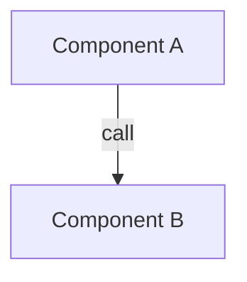

# LLD: <!-- title -->

> **TL;DR** <!-- Up to 5 lines: what gets built, the key technical choices (with ADR links), the riskiest part, and how it is phased. Write this last. -->

- Change: `<!-- change-id -->`
- HLD: [hld.md](hld.md) <!-- lite track: "none (lite)" -->
- Author: <!-- name -->
- Date: <!-- YYYY-MM-DD -->

## 1. Context and Scope

<!-- What this design covers and how it relates to the HLD goals (G1...). Lite track: state problem, goals, non-goals and the chosen approach here. -->

## 2. Architecture

<!-- Components, their responsibilities, and how they interact. New components versus changed ones. Use a diagram. -->

## 3. Data Model

<!-- Entities, fields with types and constraints, relationships, indexes, retention. Migrations of existing data. Link contracts/ for full DDL or schemas. -->

## 4. Interfaces and Contracts

<!-- Every API, event, CLI or UI contract this change adds or alters: endpoint or topic, request, response, errors, versioning. Link contracts/ files. -->

## 5. Behaviour and Error Handling

<!-- Key flows as sequence diagrams. Each failure mode: detection, response, user-visible effect, retry, timeout and idempotency rules. -->

## 6. Cross-Cutting Concerns

<!-- Security (authN/Z, trust boundaries, secrets), privacy, performance budgets, observability (logs, metrics, traces, alerts), accessibility, internationalisation. "N/A - <reason>" where one does not apply. -->

## 7. Technology and Deployment

<!-- Stack used for this change, with links to ADRs for anything new. Environments, deployment topology, configuration keys, feature flags, infrastructure changes, CI/CD changes. -->

## 8. Alternatives Considered

<!-- Design alternatives at LLD level (not covered by ADRs), and why they lost. -->

## 9. Test Strategy

<!-- Test levels (unit, integration, end-to-end, contract, performance) and what each covers. How tests name scenario IDs. Test data and environments. Coverage or quality gates. -->

## 10. Migration and Rollout

<!-- Rollout order, flags, backward compatibility, data migration, rollback plan and its trigger. "N/A - <reason>" for greenfield work. -->

## 11. Implementation Phases

<!-- Ordered phases. Each one leaves the system buildable and tested. List the scenarios each phase makes pass. -->
| Phase | Delivers | Scenarios | Exit check |
|---|---|---|---|
| P1 | | | |

## 12. File Boundary

<!-- Exact repository paths this change may create (C), modify (M) or delete (D). Globs only for generated output. The sprint phase enforces this list. -->
| Path | C/M/D | Phase | Note |
|---|---|---|---|

## 13. Risks and Mitigations

| Risk | Likelihood | Impact | Mitigation | Owner |
|---|---|---|---|---|

## 14. Traceability

<!-- Capabilities and requirement IDs introduced or changed, and the HLD goal each serves. -->
| Capability | Requirements | HLD goal |
|---|---|---|
